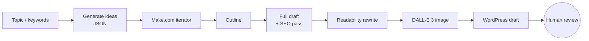

# Automated Blog Pipeline with Make.com and the OpenAI API

A no-code/low-code content pipeline that takes a topic or keyword list and produces SEO-structured blog drafts, each with its own generated image, ready for review in WordPress.

📄 **Full case study:** [Automated Blog Pipeline with ChatGPT and Make.com](https://iamnicolecoleman.com/portfolio/case-study-building-an-automatic-blog-post-generator/)

## Skills demonstrated

| Skill | Where it shows up |
|---|---|
| Workflow orchestration | Make.com scenario that iterates over ideas and chains each generation step |
| LLM structured output | Ideas returned as JSON, parsed in Make, and processed one by one |
| Prompt design | Separate prompts for ideation, outlining, drafting, SEO, and a readability rewrite |
| API integration | OpenAI (text + DALL·E 3 images) and the WordPress API |
| Human-in-the-loop design | Posts land as WordPress drafts, never auto-published |

## Pipeline

## SEO rules built into the prompts

- Five target keywords at 3–5% density
- At least three keyword-rich headers, proper H1/H2 structure, and a meta description
- Rewritten for roughly a grade-5 reading level

## Outcome

The case study estimates up to 10 hours a week saved for a content team; output volume scales with the number of input topics.

---

**Nicole Coleman** · Founder, 3509 Innovations · [LinkedIn](https://www.linkedin.com/in/nicoledcoleman/) · [Portfolio](https://iamnicolecoleman.com)
